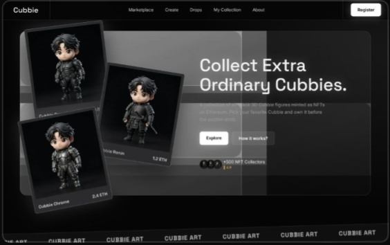

# ◈ Cubbie NFT Marketplace

<p align="center">
  
  
  
</p>

<p align="center">
  <strong>A dark-themed NFT marketplace front end for my own 3D chibi collection, CUBBIE.</strong>
  <br />
  Wallet connection, live auctions, and an upcoming drop, built with React and Vite.
</p>

<p align="center">
  <a href="https://cubbie-nft.vercel.app"><strong>↗ OPEN LIVE DEMO</strong></a>
  &nbsp; · &nbsp;
  <a href="https://github.com/ahmad-choirudin"><strong>GITHUB PROFILE</strong></a>
</p>

---

## ◈ FEATURES

<table>
  <tr>
    <td width="50%">
      <strong>01 / WALLET CONNECTION</strong><br />
      Connect through MetaMask (EIP-1193) and see your live ETH balance.
    </td>
    <td width="50%">
      <strong>02 / LIVE AUCTIONS</strong><br />
      Auction cards with live countdown timers.
    </td>
  </tr>
  <tr>
    <td width="50%">
      <strong>03 / UPCOMING DROP</strong><br />
      A dedicated drop section with a release countdown ring.
    </td>
    <td width="50%">
      <strong>04 / INTERACTIVE UI</strong><br />
      Responsive carousel, buy modal, and like interactions.
    </td>
  </tr>
</table>

## ◈ PREVIEW

<p align="center">
  
</p>

## ◈ TECH STACK

<p>
  
  
  
  
  
  
</p>

## ◈ RUN LOCALLY

```bash
cd nft-market
npm install
npm run dev
```

## ◈ NOTES

> **Frontend demo only.** The buy flow is not connected to a smart contract yet, so no real NFT transactions are executed.

UI inspired by a Flacto marketplace design reference.

## ◈ BUILT BY

**Ahmad Choirudin**

Web3 Research · Crypto Markets · DeFi · Frontend Development

<p align="center">
  <a href="https://www.ahmadchoirudin.my.id/">Portfolio</a>
  &nbsp; · &nbsp;
  <a href="https://cubbie-nft.vercel.app">Live Demo</a>
  &nbsp; · &nbsp;
  <a href="https://github.com/ahmad-choirudin">GitHub</a>
  &nbsp; · &nbsp;
  <a href="https://x.com/CubbieOG">X / @CubbieOG</a>
</p>
